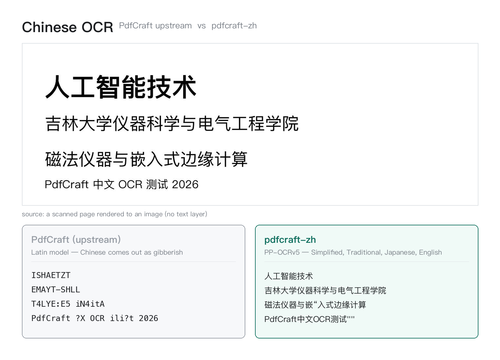

# pdfcraft-zh

Chinese localisation for [PdfCraft](https://github.com/storytold/pdfcraft).

A Python script that checks out PdfCraft's source, applies a patch, builds it,
and assembles the result into a standalone application in your own application
directory. **No existing interface element is changed** — it only makes Chinese
display properly and makes Chinese text in scans recognisable.

[中文说明](README.zh-CN.md)



## What it changes

| | Change |
|---|---|
| **Interface font** | Uses a CJK face the system already has: PingFang on macOS, Microsoft YaHei on Windows, WenQuanYi on Linux. No more falling back to a thin Japanese face |
| **Interface languages** | Reduced to Simplified Chinese / Traditional Chinese / Japanese / English (the other 19 catalogs are removed) |
| **Chinese OCR** | Scan & OCR reads Chinese: PaddleOCR's PP-OCRv5 recognition model (Simplified, Traditional, Japanese and English). The result is written back as a **searchable invisible text layer** |
| **Installation** | Assembled into a standalone `PdfCraft-zh` that sits **alongside** the original instead of replacing it |

The first two are localisation trade-offs; the third is something upstream does
not offer yet (CJK support in ocrs has been on the roadmap for a long time).

## Where it installs

| System | Location |
|---|---|
| **macOS** | `~/Applications/PdfCraft-zh.app` |
| **Windows** | `%LOCALAPPDATA%\PdfCraft-zh\`, plus a desktop shortcut |
| **Linux** | `~/.local/bin/pdfcraft` + `~/.local/share/applications/pdfcraft-zh.desktop` |

**The original PdfCraft is not modified, moved or deleted.** The two builds use
different application identifiers (`ai.storyteller.pdfcraft.zh` versus
`ai.storyteller.pdfcraft`), so they install and run side by side and are
distinguishable in the Dock and the Start menu.

Our patch ships its own icon — PdfCraft's artwork with a CJK badge in the
lower-right corner — so the two are easy to tell apart.

## Usage

**Python does not have to be installed beforehand.** The launcher finds one the
way the system provides it (and explains how to install one if there is none),
then runs the main script.

| System | How to start |
|---|---|
| **Windows** | Double-click **`run.bat`** |
| **macOS / Linux** | Run **`./run.sh`** in a terminal |

You can also run the main script directly if you already have Python:

```bash
python3 pdfcraft-zh.py
```

The script then:

1. Checks the system and environment (git, Rust toolchain)
2. Fetches the Chinese OCR models and font (about 100 MB, with progress and speed)
3. Applies the code patch
4. Builds PdfCraft
5. Runs a self-check
6. Assembles and installs

When it finishes, **PdfCraft-zh** is in your applications list (on Windows a
desktop shortcut is created as well).

**If macOS blocks the first launch** (locally built, no Apple developer
signature), click **Open Anyway** under System Settings → Privacy & Security.
This is needed only once.

### Options

```bash
python3 pdfcraft-zh.py --dir DIR      # working directory (default: current)
python3 pdfcraft-zh.py --jobs 8       # build parallelism
python3 pdfcraft-zh.py --check        # environment and asset checks only
python3 pdfcraft-zh.py --no-install   # build only; do not assemble or install
```

### Requirements

- **Python 3.8+** — auto-detected by `run.sh` / `run.bat`, with install
  instructions when missing. The main script uses the standard library only:
  **no pip needed**.
- **git**
- **Rust toolchain**: <https://rustup.rs>
  ```bash
  curl --proto '=https' --tlsv1.2 -sSf https://sh.rustup.rs | sh
  ```
- About **3 GB** of disk (source, dependencies, build output, models)

## Network problems

### Recognition model (about 80 MB, hosted on Hugging Face)

The script tries the `hf-mirror.com` mirror first, falls back to
`huggingface.co`, and downloads in 5 MB chunks with retries — long connections
tend to get cut.

**If it still times out or is interrupted**, download the file manually, put it
in place and run the script again; finished steps are skipped:

```bash
curl -L -C - -o PP-OCRv5_server_rec_infer.onnx \
  https://hf-mirror.com/marsena/paddleocr-onnx-models/resolve/main/PP-OCRv5_server_rec_infer.onnx
```

Put it in `pdfcraft/assets/models/` (the script renames it to
`text-recognition.onnx` automatically) and run again.

Checksum (verified automatically):

```
SHA256  13d0dda27d63dc0f4938af48df2c55b33f3c989a0bd5eacb8410e30f1735f644
size    84505505 bytes (80.6 MB)
```

### Detection model (about 2.4 MB)

This model only locates text, it does not read it, so one copy serves every
language — we reuse the official one as-is. Its official download host is
unreachable from many networks, so our script looks in this order:

1. The copy in this patch's `assets/` directory
2. The working directory
3. An installed PdfCraft on this machine (macOS:
   `PdfCraft.app/Contents/Resources/models/`)
4. Download

### Source repositories

The GitHub repositories (PdfCraft source, craft-fonts, ocrs-cjk) go through the
`ghfast.top` accelerator by default. If that fails, clone them yourself into the
working directory (`pdfcraft/`, `craft-fonts/`, `vendor/ocrs-cjk/`); the script
reuses anything it finds.

## Why the upstream revision is pinned

The patch is verified against PdfCraft commit `afa8e184`, and the script checks
that revision out so the patch is guaranteed to apply. When upstream moves, the
patch may need updating.

## Self-check

The script verifies that the build outputs exist, that the binaries contain the
Chinese-support signatures, that the interface font and language changes took
effect, and that the OCR assets are complete (recognition model, detection
model, alphabet length, embedded font). Anything that does not match is printed
in red and installation does not proceed.

After installing, the script also verifies the application bundle's signature so
that `codesign --verify --strict` passes.

## Directory contents

| File | Description |
|---|---|
| `pdfcraft-zh.py` | Main script (patch embedded; self-contained) |
| `run.sh` `run.command` `run.ps1` `run.bat` | Platform launchers |
| `pdfcraft-zh.patch` | Code patch (`git apply` format, 8 files) |
| `COMPLIANCE.md` `COMPLIANCE.zh-CN.md` | Why the patch may be redistributed, licence by licence |
| `docs/ocr-comparison.png` | Upstream versus pdfcraft-zh on a Chinese scan |
| `assets/PdfCraft-zh.icns` | Application icon (macOS) |
| `assets/PdfCraft-zh.png` | Application icon (Linux) |
| `assets/text-detection.rten` | Text detection model |
| `assets/licenses/` | Licence texts redistributed with the application |
| `tools/script_template.py` | Development template, with a `__CODE_PATCH__` placeholder |
| `tools/build.py` | Generates `pdfcraft-zh.py` from the template and the patch |

After changing the patch or the template, run `python3 tools/build.py` to
regenerate the main script.

## Licence and compliance

This patch script is released under the MIT Licence (`LICENSE`).

### What the patch itself distributes

The script contains neither PdfCraft's source code nor its binaries. On the
user's own machine it checks the source out from GitHub, applies
`pdfcraft-zh.patch`, and builds locally. The patch file holds only a diff, not
PdfCraft's source files.

### Licences shipped inside the assembled application

The installed application carries a complete set (on macOS under
`PdfCraft-zh.app/Contents/Resources/`, on Windows in `licenses\`, on Linux in
`~/.local/share/pdfcraft/licenses/`):

| File | Contents |
|---|---|
| `licenses/PdfCraft-LICENSE-MIT.txt` | PdfCraft's MIT licence |
| `licenses/PdfCraft-LICENSE-APACHE.txt` | PdfCraft's Apache-2.0 licence |
| `licenses/PdfCraft-NOTICE.txt` | PdfCraft's NOTICE |
| `licenses/DERIVATION.txt` | List of changes, trademark notice, statement of what was left alone |
| `licenses/ICON.txt` | Origin of the icon and how it was modified |
| `licenses/OFL-NotoSansCJKsc.txt` | OFL-1.1 licence of the embedded font |
| `licenses/CC-BY-SA-4.0.txt` | Full CC-BY-SA-4.0 text for the detection model |
| `licenses/PaddleOCR-LICENSE-APACHE.txt` | Apache-2.0 licence of the recognition model |
| `licenses/PdfCraft-zh-LICENSE.txt` | This patch's own MIT licence |
| `models/ATTRIBUTION.txt` | Attribution for both OCR models and the embedded font |

How each licence requirement is met — trademarks, the fonts that are *not*
redistributed, and why CC-BY-SA's ShareAlike does not propagate — is documented
in [COMPLIANCE.md](COMPLIANCE.md).

### Third-party material

| Resource | Source | Licence |
|---|---|---|
| PP-OCRv5 recognition model | [PaddleOCR](https://github.com/PaddlePaddle/PaddleOCR) | Apache-2.0 |
| ocrs text detection model | [ocrs-models](https://github.com/robertknight/ocrs-models) | CC-BY-SA-4.0 |
| Noto Sans CJK SC font | [craft-fonts](https://github.com/storytold/craft-fonts) / [Noto CJK](https://github.com/notofonts/noto-cjk) | OFL-1.1 |
| ocrs-cjk engine | [kent-tokyo/ocrs-cjk](https://github.com/kent-tokyo/ocrs-cjk) | MIT / Apache-2.0 |
| PdfCraft application icon | [storytold/pdfcraft](https://github.com/storytold/pdfcraft) | MIT OR Apache-2.0 |
